  

  

  

<h2>💫 About Me</h2>

🎮 I build **Roblox games and systems** in Lua

🖥️ I make **desktop tools**: small utilities, Electron and .NET apps

🦀 Getting into **Rust** for the low-level, performance-heavy stuff

🎨 I design interfaces in **Figma** before I build them

💬 Ask me about **Roblox scripting, UI design or desktop apps**

⚡ I care a lot about the details

 

  🌐 <b>Find me on:</b>&nbsp;
  
  

<h2 align="center">🧰 Languages & Tools</h2>

   
  

<h2 align="center">💻 Tech Stack</h2>

  
  
  
  
  
  
  
  
  
  
  
  
  
  
  
  
  
  

 

  

